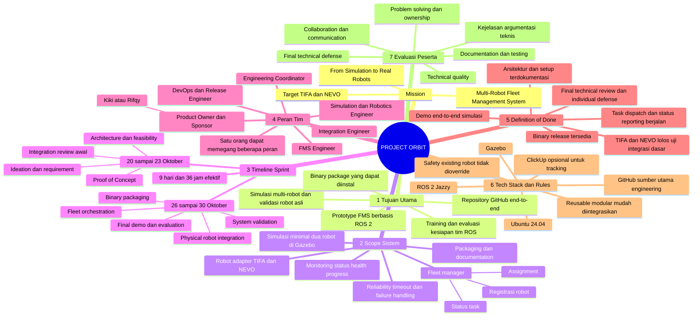

# Mind Map — Project ORBIT

[← README](../README.md)

Transkripsi struktur **Project-Based Engineering Sprint — Briefing v1** yang diberikan untuk paket ini. Tujuh cabang, misi, fase tanggal, peran, Definition of Done dan dimensi evaluasi dipertahankan untuk dokumen tim. Nama project menggunakan ORBIT; peserta mengikuti kickoff brief. Gambar sumber tidak disertakan dalam paket; gunakan diagram dan outline berikut untuk berbagi.

## Mermaid

Diagram dapat dirender oleh penampil Markdown yang mendukung Mermaid. Outline di bawah menyediakan versi teks jika renderer tidak tersedia.

## Outline untuk dibaca atau dibagikan

**Misi:** Multi-Robot Fleet Management System — from simulation to real robots. Target robot **TIFA + NEVO**.

1. **Tujuan utama:** prototype FMS berbasis ROS 2; simulasi multi-robot dan validasi robot asli; repository GitHub end-to-end; installable binary package; training dan evaluasi kesiapan tim ROS.
2. **Scope sistem:** fleet manager (registrasi, assignment, status task); minimal dua robot di Gazebo; adapter TIFA–NEVO; monitoring status, health dan progress; reliability (timeout dan failure handling dengan safety awareness); packaging dan dokumentasi.
3. **Timeline sprint:** 20–23 Oktober untuk ideation/requirements, architecture/feasibility, PoC dan integration review awal; 26–30 Oktober untuk fleet orchestration, physical integration, system validation, binary packaging, final demo dan evaluation. Total 9 hari/36 jam.
4. **Peran tim:** PO/Sponsor Kiki (Rifqy), Engineering Coordinator, FMS Engineer, Simulation/Robotics Engineer, Integration Engineer, DevOps/Release Engineer. Satu orang dapat memegang beberapa peran; lima peserta tercantum pada brief.
5. **Definition of Done:** demo end-to-end simulasi; uji integrasi dasar TIFA dan NEVO; task dispatch dan status reporting; arsitektur dan setup terdokumentasi; binary release; final technical review dan individual defense.
6. **Tech stack dan aturan:** ROS 2 Jazzy, Ubuntu 24.04, Gazebo; GitHub sebagai sumber utama; ClickUp opsional; safety existing tidak dioverride; reusable, modular dan mudah diintegrasikan.
7. **Evaluasi peserta:** technical quality, problem solving/ownership, collaboration/communication, documentation/testing, kejelasan argumentasi teknis dan final defense.

**Rangkaian output:** FMS Prototype → Simulation + Real Robot Validation → GitHub Repository → Binary Package.

Jadwal sesi: **16.00–18.00 dan 19.00–21.00 WIB**. Lihat [timeline harian](TIMELINE_9_DAYS.md) untuk pemecahan kegiatan.
