# Timeline Lengkap — 9 Hari / 36 Jam

[← README](../README.md)

**WIB (UTC+7)**. Setiap hari aktif: **16.00–18.00** dan **19.00–21.00**. Jeda 18.00–19.00 tidak masuk jam efektif. Periode 20–30 Oktober 2026 berisi 9 hari kerja; **24–25 Oktober adalah akhir pekan tanpa sesi wajib**.

Pembagian detail di bawah merupakan rencana operasional dari fase Briefing v1. Prioritas gate tetap; perubahan urutan pekerjaan dicatat pada issue dan disetujui coordinator/PO sesuai dampaknya.

| Hari | Tanggal | 16.00–18.00 WIB | 19.00–21.00 WIB | Output / exit checkpoint | Dependency / lead |
| --- | --- | --- | --- | --- | --- |
| D1 | Selasa, 20 Okt | Kickoff, peran, problem discovery; inventaris robot dan akses | Ideation semua peserta, requirements, alternatif dan risiko | Problem statement, FR/NFR, scope, daftar aset, owner map, kontribusi ide tiap engineer | Brief; PO + semua engineer |
| D2 | Rabu, 21 Okt | Feasibility matrix, kontrak FMS–adapter, arsitektur dan ADR awal | Repository workflow, CI baseline, PoC registrasi dan task dispatch | Alternatif dinilai, kontrak v0, PR pertama, CI dasar, PoC awal | D1; coordinator + FMS + release |
| D3 | Kamis, 22 Okt | Perkuat PoC lifecycle; spawn dua robot, namespace/TF dan navigasi | Integrasi FMS–sim adapter; task, feedback, hasil dan tes awal | Demo vertikal awal, automated tests awal, daftar gap G1 | Kontrak D2; FMS + simulation |
| D4 | Jumat, 23 Okt | End-to-end simulasi dua robot; task berurutan/bersamaan sesuai desain | Review G1, failure injection awal, perbaikan dan rencana fisik | Evidence G1; PASS/FAIL/BLOCKED; interface baseline dan rencana recovery | D3; coordinator + reviewer |
| — | Sabtu–Minggu, 24–25 Okt | Tidak ada sesi wajib | Tidak ada sesi wajib | Tidak menambah 36 jam sprint | — |
| D5 | Senin, 26 Okt | Fleet orchestration: antrean, eligibility, timeout dan reliability | Adapter TIFA/NEVO: bench check, status, koneksi dan preflight | Hasil fault test, adapter mapping, kesiapan uji fisik | Review D4; FMS + integration |
| D6 | Selasa, 27 Okt | Pengujian fisik TIFA: registrasi, dispatch, feedback, stop dan hasil | Pengujian fisik NEVO dengan kontrak yang sama; review gap | Dua laporan uji awal, bukti run, temuan dan owner perbaikan | Preflight lolos; integration + operator |
| D7 | Rabu, 28 Okt | System test FMS–TIFA–NEVO; koordinasi area/jalur dan fault scenario aman | Review G2, regresi, perbaikan, freeze fitur dan persiapan packaging | Status G2, regression report, release candidate scope | D6 dan perbaikan; coordinator + integration |
| D8 | Kamis, 29 Okt | Build binary berversi, CI release, dependency dan checksum | Clean install pada environment target; smoke test dan demo rehearsal | Artifact kandidat, install report, rehearsal G3, runbook final | Fitur D7; release + reviewer independen |
| D9 | Jumat, 30 Okt | Demo final G1–G3, verifikasi artifact/evidence dan technical review | Individual technical defense, scorecard, keputusan G4, retrospective dan handoff | Status G1–G4, binary release, evaluation report, known issues dan tindak lanjut | Evidence D1–D8; semua engineer + PO |

## Ritme setiap sesi

- Awal: ringkas hasil sebelumnya, target sesi dan blocker.
- Waktu kerja utama: implementasi, pairing, review atau tes sesuai rencana.
- Akhir: tunjukkan hasil, tautkan PR/commit/evidence, tulis kegagalan dan next action.

Status harian harus menyebut **hasil yang dapat diperiksa**, bukan hanya persentase selesai. Gunakan [Daily Update](../templates/DAILY_UPDATE.md).

## Jalur kritis

```mermaid
flowchart LR
  D1["D1: problem dan requirements"] --> D2["D2: kontrak dan feasibility"]
  D2 --> D3["D3: PoC terintegrasi"]
  D3 --> G1["D4: review G1 simulasi"]
  G1 --> D5["D5: reliability dan bench check"]
  D5 --> D6["D6: TIFA dan NEVO"]
  D6 --> G2["D7: review G2 dan regresi"]
  G2 --> G3["D8: binary dan clean install"]
  G3 --> END["D9: final G1-G4 dan defense"]
```

## Aturan saat checkpoint gagal

| Kondisi | Tindakan |
| --- | --- |
| G1 belum lulus D4 | Buat recovery plan untuk D5, kurangi fitur tambahan, ulangi tes sebelum alur end-to-end fisik |
| Robot belum aman/tersedia | Lanjutkan bench test atau simulasi yang memungkinkan; G2 tetap BLOCKED sampai ada bukti fisik |
| G2 gagal D7 | Isolasi defect, tetapkan owner dan retest; packaging bagian stabil dapat berjalan, status gate tetap jujur |
| Binary gagal clean install D8 | Bekukan fitur, perbaiki dependency/packaging, ulangi install dari lingkungan bersih |
| Gate belum lulus D9 | Handoff dengan gap, evidence, owner dan rencana perbaikan; jangan menyatakan sprint lengkap |

## Alokasi defense D9

Untuk lima peserta, sediakan **20 menit per orang** pada sesi malam: 5 menit kontribusi dan evidence, 10 menit pertanyaan teknis, 5 menit feedback. Total 100 menit; 20 menit terakhir untuk rekap hasil dan retrospective. Penyesuaian alokasi diumumkan jika jumlah peserta berubah.
